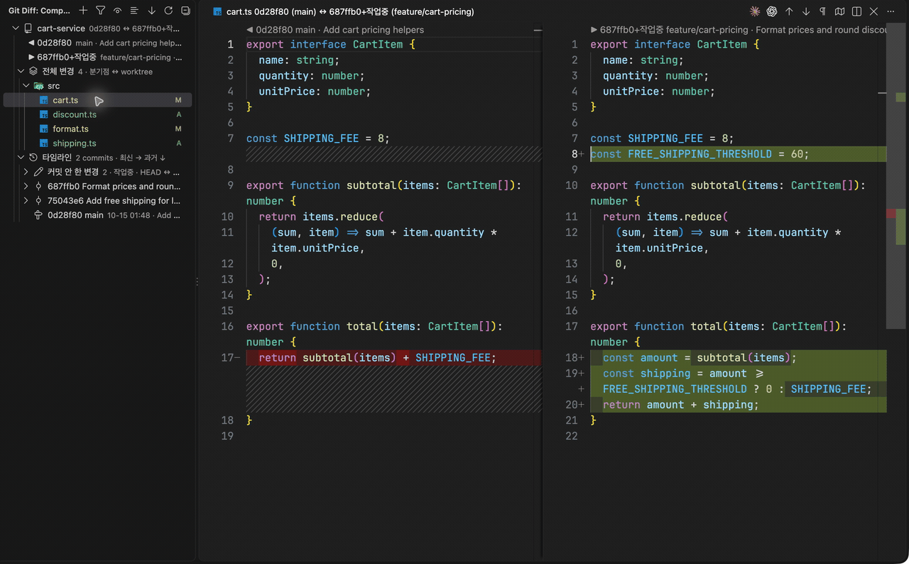

# Git Diff View

Review your branch's changes in VS Code, from the point it diverged from a base branch to your
current files. Browse changed files, step through commits, and open side-by-side diffs with each
revision clearly labelled.

- Review the combined changes or inspect one commit at a time.
- Include saved uncommitted changes and untracked files.
- Browse files as a folder tree or a flat list, with path and status filters.
- Open all visible changes together in VS Code's multi-diff editor.
- Keep multiple repository comparisons in one sidebar, restored across VS Code restarts.



## Installation

Requires **VS Code 1.95 or later** and **Git** available on your `PATH`.

Install [Git Diff View from the Visual Studio Marketplace](https://marketplace.visualstudio.com/items?itemName=studykit.git-diff-view),
or run:

```sh
code --install-extension studykit.git-diff-view
```

To install a downloaded `.vsix` file, open the Command Palette and run **Extensions: Install from
VSIX…**, then select the file. After an update, run **Developer: Reload Window** if needed.

## Open your first comparison

1. Open the Command Palette (`Cmd+Shift+P` on macOS, `Ctrl+Shift+P` on Windows/Linux).
2. Run **Git Diff: Compare Repo with Ref…**.
3. Select a repository, or browse to a repository folder.
4. Select the branch or tag you want to compare against, such as `origin/main`.
5. In the **Git Diff** sidebar, expand **All changes** (`전체 변경`) and click a file to open its diff.

You can also start a comparison with the **+** button in the sidebar. Comparisons can include
repositories outside your current workspace.

## Choose what to compare

The default comparison starts at the **merge-base**: the common ancestor of your current branch
and the selected base ref. It shows changes since those branches diverged, up to the current
contents of your working tree.

To compare the selected base ref's current commit directly with your working tree, right-click
the comparison and choose **Compare with Base Directly**. Choose **Compare from Merge-Base** to
switch back.

## Review changes

Each comparison contains:

- **Revision labels** showing the commit, branch or ref, and commit subject on each side.
- **All changes** (`전체 변경`) for the combined difference from the comparison's starting commit
  to your current files.
- **Timeline** (`타임라인`) for individual commits, plus **Uncommitted changes** (`커밋 안 한 변경`)
  when your working tree has changes. Click a file under a commit to compare it with that
  commit's first parent.

Files show their Git status: **A** (added), **M** (modified), **D** (deleted), or **R** (renamed).
Both diff panes are read-only. Open the original file in your normal editor to make changes.
Save edits before reviewing them; working-tree comparisons use the files on disk.

Right-click a comparison or a change group and choose **Open All Changes** to review its visible
changes together in the multi-diff editor. Use **Close Comparison** to remove a comparison from
the sidebar.

### Adjust the view

Use the sidebar toolbar or the corresponding **Git Diff** commands in the Command Palette:

| Action | What it does |
| --- | --- |
| **View as List** / **View as Tree** | Switch between a flat file list and folders. |
| **Show Unchanged Files Too** / **Show Changed Files Only** | Include surrounding files for context, or focus on changes. |
| **Timeline: Oldest First** / **Timeline: Newest First** | Change the order of commits. Newest first is the default. |
| **Refresh** | Reload comparisons from Git and your saved files. |

Changed folders expand automatically. Use **Expand Changed Folders** on a comparison, change
group, or folder to reopen all folders containing changes. Clicking an unchanged file opens
that revision in a read-only editor.

Comparisons refresh when you save a file in a compared repository or return to the VS Code
window. Use **Refresh** after changes made outside the editor if the view is out of date.

## Filter files

Run **Git Diff: Filter Files…** or use the filter button in the sidebar. Enter path patterns
separated by commas, then choose which Git statuses to show.

```text
src/**, !**/test/**
```

This shows files under `src/` and excludes paths containing a `test` folder. Patterns are
relative to the repository root; `*` matches within a path segment, `**` spans folders, and `?`
matches one character. Prefix a pattern with `!` to exclude it. Leave the path input empty to
filter only by status.

Filters apply to every comparison and to **Open All Changes**. When unchanged files are shown,
only the path patterns apply to those files. Run **Git Diff: Clear Filter** to remove the path
and status filters.

## Open comparisons from a terminal

On **macOS or Linux**, run **Git Diff: Install git-diff-view in ~/.local/bin** from the Command
Palette or the empty Comparisons view. This installs the terminal command with executable
permissions. Run it again after updating the extension to update the script; replacing a
different existing file requires confirmation.

The terminal command requires `git` and `python3`, plus `open` on macOS or the VS Code `code`
command on Linux.

```sh
# Compare the current repository with its default base.
git-diff-view

# Compare a repository with a specific base, starting at the merge-base.
git-diff-view /path/to/repo origin/main

# Compare the base ref directly with the current repository's files.
git-diff-view . origin/main --direct
```

Syntax: `git-diff-view [repo] [base] [--direct]`

`repo` defaults to the current directory. `base` defaults to `origin/HEAD` when available,
falling back to common `develop`, `main`, or `master` refs, then `HEAD`. The comparison opens in
the last active VS Code window. Run `git-diff-view --help` for a usage reminder.

If your terminal cannot find `git-diff-view`, add this to your shell startup file (for example,
`~/.zshrc`) and open a new terminal:

```sh
export PATH="$HOME/.local/bin:$PATH"
```

The installer offers **Copy PATH Command** when this directory is missing from VS Code's `PATH`.

## Use with Claude Code or Codex

The shared `git-diff-view` skill lets an agent open comparisons using the terminal command.
Install `git-diff-view` as described above first. The skill installer requires Node.js and npm.

### Project installation (default)

Run this from the root of the project where you use your agent:

```sh
npx skills add studykit/vscode-git-diff \
  --skill git-diff-view \
  --agent claude-code codex
```

Choose **Symlink** when asked for the installation method. The skill is installed in the
project's `.agents/skills/git-diff-view/` for Codex, with a link from
`.claude/skills/git-diff-view/` for Claude Code. Choose only the agent you use by changing the
`--agent` argument to `claude-code` or `codex`.

Invoke it in Claude Code with `/git-diff-view origin/main`, or in Codex with
`$git-diff-view` followed by a request such as "Show this repository's changes against
origin/main in VS Code."

### Global installation (optional)

To make the skill available across all your projects, explicitly add `--global`:

```sh
npx skills add studykit/vscode-git-diff \
  --skill git-diff-view \
  --agent claude-code codex \
  --global
```

The CLI remains at `~/.local/bin/git-diff-view` for either installation scope.

## Troubleshooting

- **A comparison shows an error:** check that its repository still exists and the base ref is
  available locally. Fetch remote refs with Git, then run **Git Diff: Refresh**.
- **Revision labels above the diff are missing:** enable **Editor: Code Lens** in VS Code settings.
- **You need more detail about an error:** open the **Output** panel and select **Git Diff**.
